<div align="center">


# 岛仔 · Daozai（自定义构建）

**一座小岛，装下桌面日常。**

Windows 桌面信息岛，抬眼就能看消息、歌词、日程、天气、系统性能、蓝牙电量和 AI 额度。

[](https://github.com/cayww/daozai-custom/releases/latest)
[](#下载安装)
[](LICENSE)
[](#从源码构建与参与开发)

**[下载 Windows 版](https://github.com/cayww/daozai-custom/releases/latest)** · [更新记录](CHANGELOG.md) · [使用指南](docs/USAGE.md) · [反馈问题](https://github.com/cayww/daozai-custom/issues)

</div>

> ### 本仓库是个人定制版（daozai-custom）
>
> 基于上游 [Renly1994/xiaotang-daozai](https://github.com/Renly1994/xiaotang-daozai) 深度定制，
> 与原作者无关、也未获其背书；功能问题请提到
> [本仓库 Issues](https://github.com/cayww/daozai-custom/issues)，**不要反馈给上游**。
> 本仓库使用自己的版本号（1.x），保留 D3D11 自绘栈与液态玻璃等定制功能。
> 最新发布说明见 [v1.4.0 Release Notes](docs/RELEASE_NOTES-1.4.0.md)；上游同期的更新见 [上游 v0.6.70 发布说明](https://github.com/Renly1994/xiaotang-daozai/releases/tag/v0.6.70)。
> 接手开发请先读 [`docs/HANDOFF.md`](docs/HANDOFF.md)。
>
> 构建：`cd . && cargo build --locked --release --bin daozai`；
> 全量测试需加 `-- --test-threads=1`。

岛仔是一款开源的 Windows 桌面小工具。平时收起在屏幕边缘，鼠标靠近就展开；切歌、看日程、复制验证码、记一条待办，都能顺手完成。小岛里的伙伴会眨眼、打盹、喝水，也会跟着音乐唱歌。

你可以选刘海或胶囊，放在屏幕顶部、底部、左侧或右侧，只保留自己需要的功能。岛仔使用 Rust 和 egui 构建，不依赖 Electron。

## 星标增长曲线

横轴是日期，纵轴是 GitHub 累计星标数。点击图表可以打开 Star History 查看。

<a href="https://www.star-history.com/?repos=Renly1994%2Fxiaotang-daozai&amp;type=date">
  <picture>
    <source media="(prefers-color-scheme: dark)" srcset="https://api.star-history.com/chart?repos=Renly1994/xiaotang-daozai&amp;type=date&amp;theme=dark" />
    <source media="(prefers-color-scheme: light)" srcset="https://api.star-history.com/chart?repos=Renly1994/xiaotang-daozai&amp;type=date" />
    
  </picture>
</a>

## 微信里有新消息，看一眼岛边

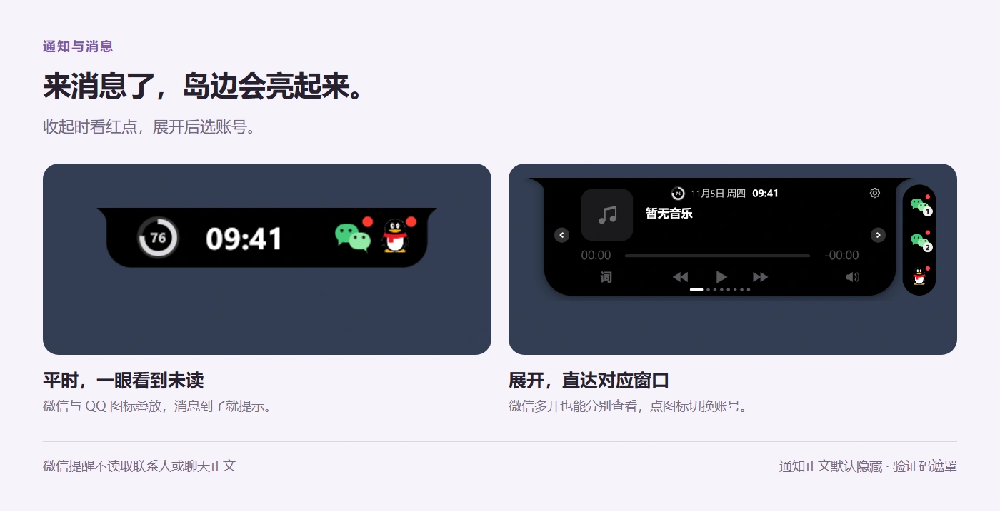

- **微信、QQ 未读提醒**：收起时亮起图标和红点，展开后在面板旁查看，点击切换到对应窗口。
- **微信多开分开看**：不同账号分别显示，点击对应账号的未读图标即可切换。
- **按需显示通知正文**：默认隐藏正文；开启预览后仍遮罩识别出的验证码。
- **微信提醒不读取聊天正文**：根据任务栏闪动提示新消息。微信缩在托盘时，可选开启「托盘一键唤起微信」。
- **企业微信、飞书和钉钉**：在消息提醒设置里分别开启，并确认对应客户端允许任务栏闪动。新消息会在岛上提醒，点一下即可打开对应窗口。

在 **设置 → 消息提醒** 开启「微信」。QQ 可从「QQ 与其他应用 → 连接…」选择「只连接 QQ」，并在 QQ 中启用 Windows 系统通知。

## 换个皮肤，也换个位置

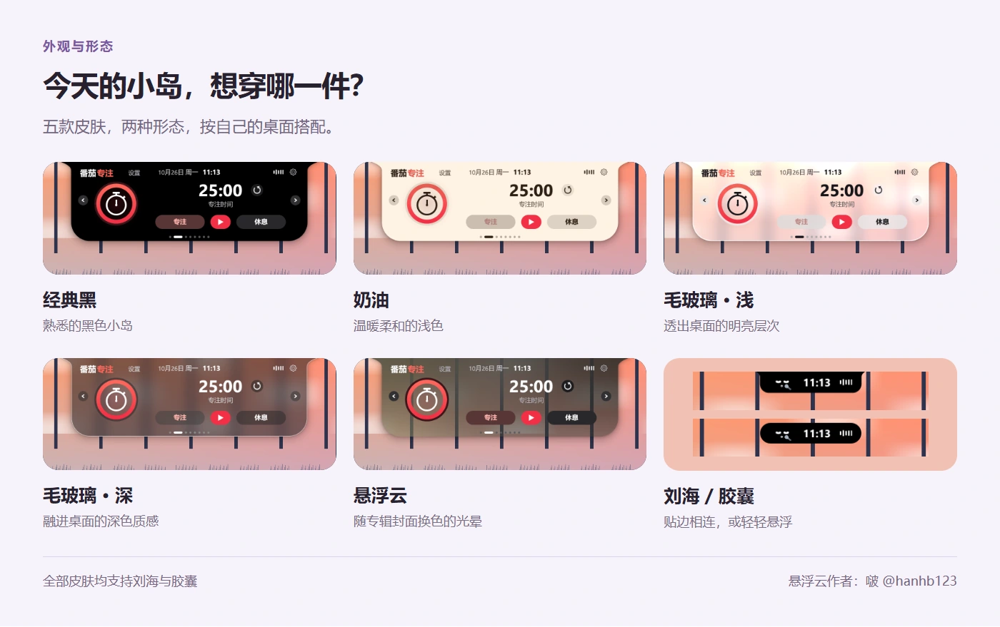

**五款皮肤 × 两种形态，自由搭配。** 经典黑、奶油、毛玻璃·浅、毛玻璃·深和「悬浮云」，都能搭配刘海或胶囊。毛玻璃透出身后的桌面；悬浮云随专辑封面换色，光晕跟着鼠标移动。

本构建额外提供 **液态玻璃** 渲染（D3D11 自绘栈）：支持自动 / 深色 / 浅色主题模式，按背景亮度自动切换或手动固定；亮度采样采用 WCAG 相对亮度与分区采样，浅色背景下的文字对比度更稳。液态玻璃等定制改动见 [v1.4.0 发布说明](docs/RELEASE_NOTES-1.4.0.md)。

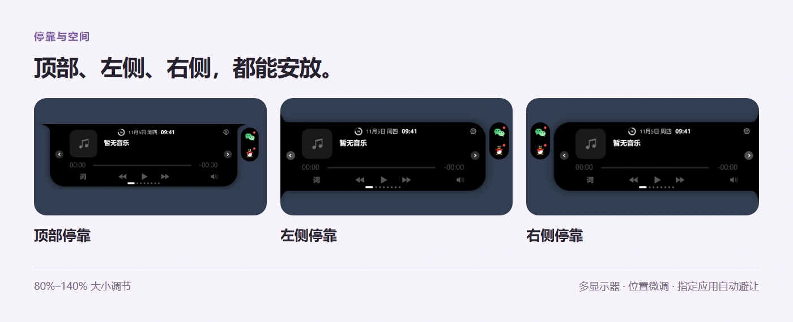

- **四边停靠**：顶部和底部横向排列，底部向上展开，会跟随自动隐藏的任务栏。左右侧边收起为竖向胶囊，鼠标靠近后从屏幕边缘展开。
- **大小与位置可调**：岛体大小支持 80%–140%，上下停靠可左右移动，侧边可上下调整。展开后按住日期时间，可以切换停靠边或把小岛拖到另一块屏幕。
- **OLED 像素偏移**（默认关闭）：收起静止时沿停靠边缓慢移动几个像素，帮助减轻 OLED 静态显示留下的痕迹。
- **多屏与自动避让**：跟随主屏或固定到指定显示器。前台浏览器或自定义应用的窗口遮住岛时，岛会收成贴边细线。切到插件浮窗时，如果名单里的宿主窗口仍遮住岛，岛会继续避让。
- **按习惯显示**：支持极简模式、12／24 小时制，以及功能页面开关与拖动排序。

在 **设置 → 外观／位置** 里分别调整皮肤、形态和停靠。岛上单行歌词支持顶部和底部停靠。

在 **设置 → 通用** 开启「在截图和录屏中隐藏岛仔」后，桌面照常显示小岛，兼容的截图和录屏工具会略过它。该选项需要 Windows 10 2004 或更新版本。

## 插件集市

官方和社区一起为小岛扩展功能。插件可以更换外观材质、增加功能页，也可以扩展页面切换和无线设备兼容。

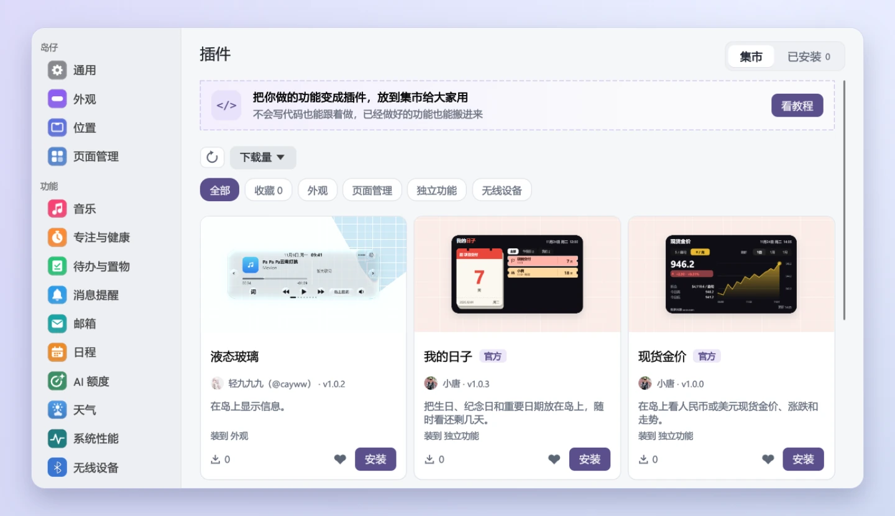

集市里有**液态玻璃、我的日子、现货金价、实时工资、便签本、世界时钟、页面快捷切换和无线设备兼容包**等插件。

[浏览岛仔插件仓](https://github.com/Renly1994/xiaotang-daozai-plugins)

## 听歌时，歌词就在抬眼处


播放、暂停、切歌、调节音量和拖动进度，都能在岛上操作。展开看歌词，也可以收起后只留一行歌词，让桌面继续做自己的事。

- 通过 Windows 媒体会话读取播放信息，并针对网易云音乐、QQ 音乐、酷狗、汽水音乐和波点音乐补充兼容。
- 网易云优先按歌曲 ID 找词，改善译名、合唱署名和 Live／Remix 等不同版本的匹配。
- 切歌、暂停和拖动进度时更快同步到岛上，改善了网易云和酷狗部分版本的进度适配。

播放器需提供可用的媒体信息；歌词取决于歌曲元数据与歌词来源，个别歌曲或播放器版本可能无法显示。

## 日程、待办和专注，放在一起

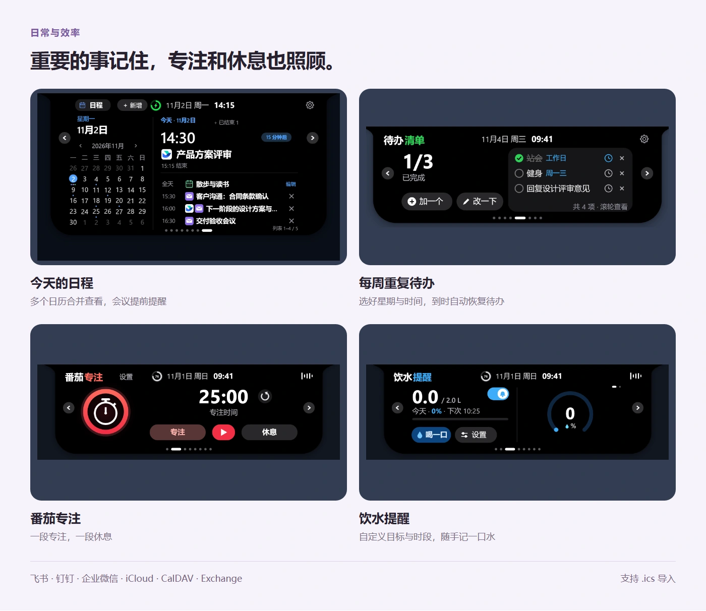

| 想做的事 | 岛仔能帮你 |
| --- | --- |
| 看今天的安排 | 月历与当日时间线，合并多个日历和正式邮件邀请，提前提醒会议 |
| 记住每周的事 | 待办支持单次提醒、每周指定日期重复或每天重复；下一次到来时恢复为待办 |
| 专心做一件事 | 专注与休息计时，收起时也能查看进度 |
| 记得喝水 | 自定义每日目标、单次饮水量、提醒间隔与时段，记录错误可撤销 |

日历可接入 **飞书、钉钉、企业微信、iCloud、自定义 CalDAV 和兼容的 Exchange ActiveSync**，也能导入 `.ics` 文件。相同日程合并去重；支持全天、跨天和重复日程。

日程可按日期浏览，月历能看农历和节气。新建本机日程时可直接选日期和时间。在 **设置 → 通用** 可把公历、农历或两者一起放到岛上常驻。

本机新建或导入的日程保存在本机；远程日历为只读同步。程序退出、电脑关机或睡眠期间无法持续提醒。

## 文件先放岛上，刚复制的字也能找回

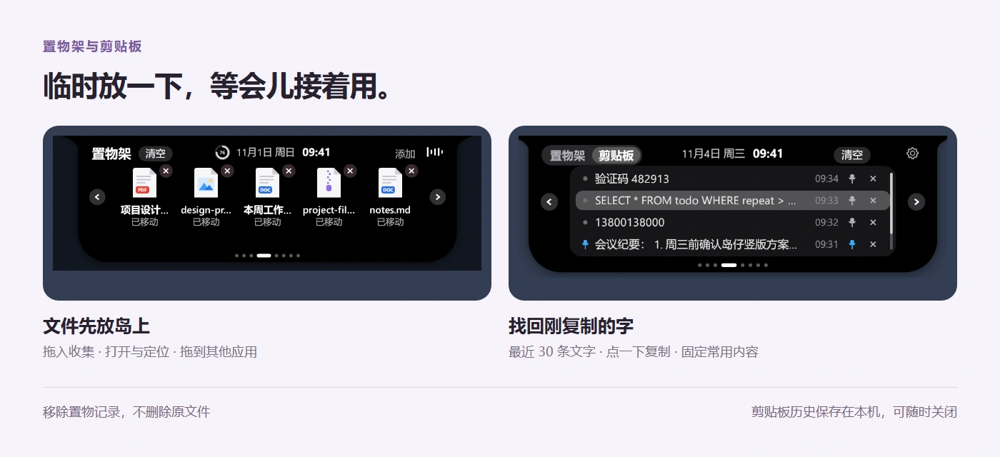

**文件置物架**：拖入文件临时收集，点击打开、定位原文件，或拖出到其他应用。移除记录不会删除原文件。

**剪贴板**：找回最近复制的 30 条文字，点一下重新复制，常用内容可以固定；复制的图片（截图、浏览器／聊天里的图）也会进入历史，点击即可复制回去。历史保存在本机，重启后仍可查看；可在 **设置 → 待办与置物 → 剪贴板** 中关闭。密码管理器标记为敏感的内容不记录。

在置物架或剪贴板页点「保持展开」，鼠标移开后面板仍会留在桌面，方便连续拖放或复制。

## 验证码少切一次窗口，邮件也能直接读

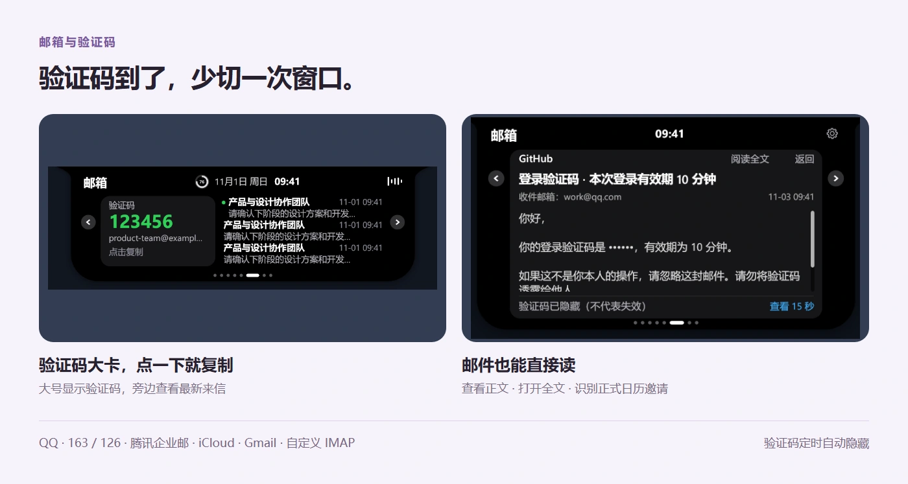

连接多个邮箱，在岛上查看来信、识别验证码并点击复制。邮件支持正文阅读与独立全文窗口，网页链接交给默认浏览器打开；正式日历邀请可进入日程。支持已读／未读切换、全部已读、移到回收站及恢复；默认仅在本机整理，可在邮件设置中开启「同步邮件操作到邮箱」。

支持 **QQ、163、126、腾讯企业邮、iCloud、Gmail 和自定义 IMAP**。验证码可设置在 30／60／300 秒后自动隐藏，覆盖列表、正文与通知；主动查看后会再次隐藏。

- 在 **设置 → 邮箱** 开启「仅提醒验证码邮件」，普通来信照常收取，可在邮件列表里查看。
- 开启「验证码高亮」后，可以再打开「避让时弹出验证码」。小岛自动避让时，新验证码也可短暂显示为横幅，点击即可复制。
- Gmail 收信可按需开启「使用 Windows 手动代理」。

## AI 还剩多少额度，抬眼就知道

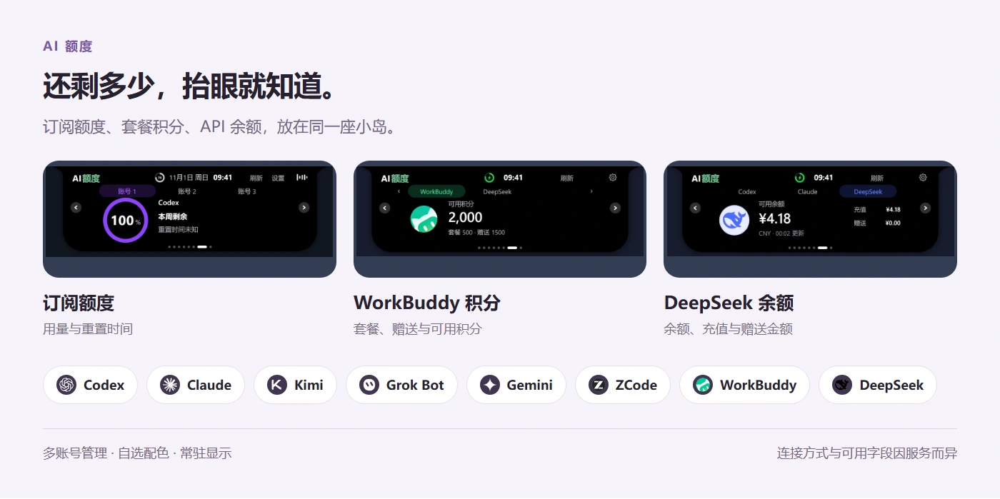

支持 **Codex、Claude、Kimi、Grok Bot、Gemini、GLM Coding Plan、WorkBuddy、DeepSeek、Kiro、豆包、OpenCode Go、MiniMax Coding Plan 和 Antigravity**。

订阅额度、重置时间、套餐积分与 API 余额，按服务展示。多个账号可分别命名、选择配色，常用账号直接放在收起的小岛上。

- **GLM / ZCode**：填写 Coding Plan 套餐 Key 查询额度。本机 ZCode 的旧连接可在 AI 额度设置中重新连接；Start Plan 体验额度在 ZCode 官方客户端查看。
- **Claude**：只读取桌面版本地用量历史与缓存，或接收 Claude Code 官方状态栏输出；岛仔不使用 Claude 登录令牌，也不请求 Claude 额度接口。数据随官方客户端使用更新，桌面版缓存有效时自动显示重置时间，读取不到时显示未知。
- **Kiro**：只读识别 Kiro 登录缓存并核验用户，显示套餐、有效试用与赠送 / 加购点数及明细，超额上限单独显示；支持美国东部和欧洲中部区域。不自动续期，登录过期时请在 Kiro 中重新登录。
- **WorkBuddy**：查看剩余积分；优先识别本机客户端登录，也可在默认浏览器完成授权。
- **Gemini**：支持 Chrome 144+ 原生授权连接，读取官网的 5 小时与每周额度，无需扩展。先在 Chrome 登录 Gemini，首次在 `chrome://inspect/#remote-debugging` 开启连接，回岛仔点击连接并在 Chrome 允许授权；会话加密保存在本机，后续独立刷新。高级设置保留手动 Cookie 连接。
- **DeepSeek**：使用 API Key 连接，查看账户余额、充值与赠送金额。
- **中转站**：自动识别通用余额、New API 和 Sub2API，保留 One API 兼容计费接口；New API 可用用户 Token 查询账户余额。高级设置支持粘贴 CC Switch 的 `request` / `extractor` 自定义查询脚本，脚本与凭据加密保存在本机。中转站可选择彩色图标，自定义查询也可连接本机 HTTP 服务（`localhost`、`127.0.0.1` 或 `[::1]`）。
- **豆包**可在独立浏览器窗口登录或从本机客户端导入，查看网页会员的 5 小时、每周及活动额度。
- **Antigravity** 读取已经登录的官方 CLI 账号额度。请先在官方 CLI 中登录，再在岛仔添加来源。
- **OpenCode Go 和 MiniMax Coding Plan** 提供套餐 API Key 连接入口。

连接方式、可用字段与账号订阅有关；请求失败或登录过期时，以对应服务的官方页面为准。

## 出门前先看一眼天气

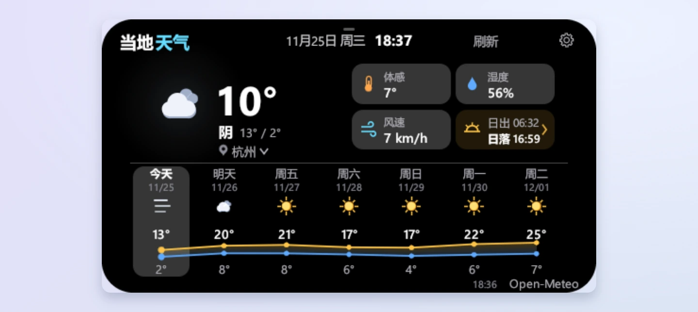

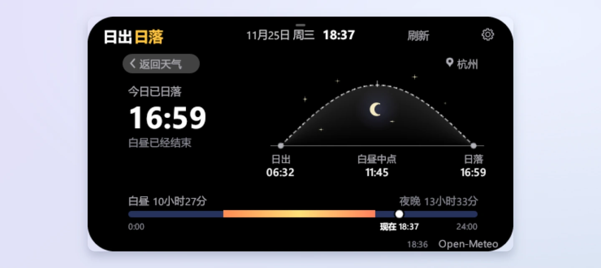

天气页显示当前实况与未来七天预报：温度、天气现象、体感、湿度、风速、日出日落时间，以及每天的最高／最低温和降水概率。

- 默认按当前网络出口自动定位，**设置 → 天气** 里也可以填城市名（中英文都行），或点「自动定位」清除。城市输入按回车或点「刷新天气」后生效。
- 数据来自 **Open-Meteo**（免费、无需密钥），每 15 分钟自动更新，也可以在页面右上角手动刷新。天气请求优先直连，必要时再尝试已配置的代理；定位主服务失败时尝试备用服务。同一城市请求间隔至少 30 秒，失败后至少 2 分钟；关闭天气模块后停止后续自动查询。
- 可选 **和风天气（自备 Key）**：在天气设置填写专属 Host 和 API Key，测试通过并选择和风城市后点「保存并启用」。仅需 GeoAPI 与天气预报两类权限，Key 保存在 Windows 凭据管理器；配置可收起，配置网站与离线长图教程在配置标题旁；支持省份下拉、自动模糊搜索和独立保存最多 5 个城市。和风与默认源的城市、缓存分开，实况约每 60 分钟、七日预报约每 6 小时更新。本机每自然月最多 5,000 次请求；和风账号合计前 50,000 次免费，超额可能收费。
- 结果缓存在本机：断网时继续显示上次的数据，并用橙色标出更新时间。
- 岛收起时常驻栏默认在时间后面显示天气图标和当前温度（如 `🌧 9°`），点它直接进天气页；可在「页面管理 → 常驻排列」中独立拖动天气，在「状态组件」中单独关闭常驻天气，天气页仍可使用。

## 系统性能和蓝牙电量，抬眼就能看

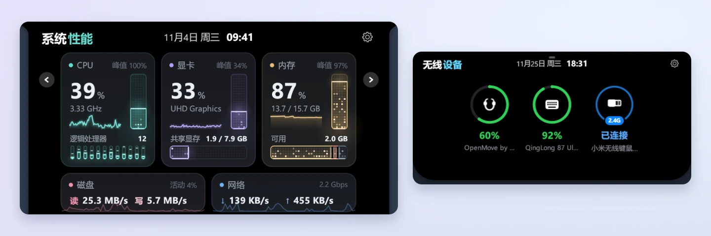

- **系统性能**可查看 CPU、显卡、内存、磁盘和网络。展开后点对应指标看详情，也能把常看的指标和实时网速留在收起的小岛上。在 **设置 → 页面管理** 开启系统性能页，再到「系统性能」选择常驻内容。
- **无线设备**可查看蓝牙设备的电量和连接状态，以及已识别的 2.4G USB 接收器的连接状态。最多可选两台蓝牙设备常驻岛上，设备未上报电量时只显示连接状态。支持上报电量的设备可设置低电量提醒。遇到未识别的型号，可从集市安装无线设备兼容包，或在 **设置 → 无线设备 → 设备兼容** 反馈。

## 还有这些顺手的小功能

电源状态、电脑电量、网络变化、音量、大写锁定和输入语言，都能在小岛上提示。通知、蓝牙监听与不常用的功能页可以按需关闭。

兼容渲染下，鼠标悬停展开、移开收起和滚轮翻页的过渡更顺滑。切页时顶栏和翻页箭头的位置也更稳定。

## 下载安装

前往 **[本仓库最新正式版](https://github.com/cayww/daozai-custom/releases/latest)**，按使用习惯选择：

| 下载文件 | 使用方式 |
| --- | --- |
| `Daozai-Setup-v版本号-x64.exe` | **推荐**。双击安装，可自行指定安装目录（默认 `C:\Program Files\DaozaiCustom`）、桌面快捷方式和开机自启 |
| `Daozai-v版本号-windows-x64.zip` | 免安装。完整解压后运行 `daozai.exe`，用户数据仍保存在 `%APPDATA%\DaozaiCustom` |

每个 release 的构建文件大小与 SHA256 见对应的发布说明，如 [v1.4.0 发布说明](docs/RELEASE_NOTES-1.4.0.md)；下载后可用 PowerShell `Get-FileHash -Algorithm SHA256` 比对。

首次安装默认创建桌面快捷方式、不开机自启。安装后从小岛或托盘打开设置，选择需要的功能和连接。

**更新**：设置 → 关于 → 检查更新。支持应用内下载、校验后重启更新，也可从发布页下载覆盖安装；升级保留原设置和数据，卸载同样保留用户数据。

自动更新提示集中在启动时，稍晚查到的版本可在「关于」查看。需要反馈问题时，可以从设置、开始菜单或免安装包使用「收集岛仔诊断」，直接生成 ZIP 文件。

**系统**：Windows 10／11 x64。本构建使用 D3D11 自绘栈与液态玻璃渲染。Windows 11 已进行本机实测，Windows 10、不同显卡及多屏组合仍需更多反馈。暂不提供 macOS、Linux 或 ARM64 成品包。

当前程序未做商业代码签名，Windows 可能提示未知发布者；请核对仓库来源与文件校验值。更多操作见 [使用指南](docs/USAGE.md)。

<details>
<summary><b>连接服务之前，需要准备什么？</b></summary>

| 类型 | 支持入口 | 需要准备 |
| --- | --- | --- |
| 邮箱 | QQ、163、126、腾讯企业邮、iCloud、Gmail、自定义 IMAP | 启用 IMAP，填写授权码或 App 专用密码；自定义服务可填写服务器、端口与登录用户名 |
| 日历 | 飞书、钉钉、企业微信、iCloud、CalDAV、Exchange ActiveSync | 服务商提供的日历同步凭据与必要的服务器地址；安装桌面客户端不等于授权 |
| AI 额度 | Codex、Claude、Kimi、Grok Bot、Gemini、GLM Coding Plan、WorkBuddy、DeepSeek、Kiro、豆包、OpenCode Go、MiniMax Coding Plan 和 Antigravity | 对应客户端登录、独立授权或 API Key；具体以设置中的连接入口为准 |

QQ 收信、邮件日程和飞书个人日历已进行真实账号测试。其他日历入口的可用性与服务端配置、权限和兼容性有关；钉钉、企业微信尚未完成本轮真实账号同步验收。

</details>

<details>
<summary><b>数据与隐私</b></summary>

- 设置、待办、本机日程、饮水记录、剪贴板历史、置物路径与连接元数据保存在 `%APPDATA%\DaozaiCustom`。
- 邮箱和日历密码、DeepSeek API Key 保存在 Windows 凭据管理器；独立 Gemini、WorkBuddy 会话使用 Windows DPAPI 加密。
- 微信新消息提醒根据任务栏闪动工作，不读取联系人或聊天正文；QQ 与应用通知需要相应的系统通知权限。
- 读取已有 AI 客户端登录时不回写原客户端配置。不要把授权码、Cookie、API Key 或登录 JSON 上传到 Issue。
- 邮箱读取收件箱，不读取垃圾邮件文件夹；邮件正文在当前进程中用于展示和识别。
- 岛仔没有自建的邮件或日程上传后台；开启联网功能后，会访问对应服务商与歌词服务。
- 天气只用城市名或由定位服务给出的经纬度查询 Open-Meteo；自动定位通过 `ipwho.is` 获取大致城市，失败时尝试 FreeIPAPI，不读取账号信息。最近一次天气结果缓存在 `%APPDATA%\DaozaiCustom\weather-cities.json`；本机连接诊断只记录服务域名、请求阶段、路由、耗时及错误类别，不记录 IP、坐标或代理凭据，不会自动上传。
- 插件集市从 Gitee 加载目录、封面和作者头像。下载与收藏统计使用随机安装标识和该插件的操作记录。
- 感谢墙的公开名单和图片从 GitHub Pages 加载并缓存在本机。

完整说明见 [隐私与安全](docs/PRIVACY.md)。

</details>

<details>
<summary id="从源码构建与参与开发"><b>从源码构建与参与开发</b></summary>

需要 Rust stable、MSVC C++ 构建工具和 Windows SDK。仓库根就是 Cargo 包目录（标准布局）：

```powershell
rustup default stable-x86_64-pc-windows-msvc
cargo build --locked --release --bin daozai
.\target\release\daozai.exe
```

运行测试与打包：

```powershell
cargo test --locked --release --lib -- --test-threads=1
```

**发布资源只走一个入口**：`installer\build-innosetup.ps1`（Inno Setup）。它会构建主程序、bridge 和内置电量组件，编译 `installer\daozai.iss`，并在 `dist\` 产出历史命名的安装包、便携 zip 与校验和：

```powershell
powershell -NoProfile -File installer\build-innosetup.ps1
# 自测用：可复用已有 dev-release 产物，跳过构建
powershell -NoProfile -File installer\build-innosetup.ps1 -CargoProfile dev-release -SkipBuild
```

产物：`Daozai-Setup-v<版本>-x64.exe`、`Daozai-v<版本>-windows-x64.zip`、`SHA256SUMS.txt`。zip 的名字与内部结构对齐应用内更新检查，不能用别的方式替代。NSIS（`setup.nsi` / `scripts\package.ps1` / `get-nsis.ps1`）已移除，GitHub Actions 也只验证 Inno 打包。

测试按单线程运行，以隔离使用进程环境变量的数据目录测试；dev-release profile 可加快增量构建。低内存设备可设置 `$env:CARGO_BUILD_JOBS = "1"`。

项目结构、界面预览与贡献方式见 [开发指南](CONTRIBUTING.md)；接手开发请读 [`docs/HANDOFF.md`](docs/HANDOFF.md)。

</details>

## 开源与致谢

岛仔原创代码采用 [MIT License](LICENSE)。Rust 依赖、第三方图标及品牌标识沿用各自的许可或权利声明；MIT 不授予服务商标使用权，也不代表官方合作或认证。详见 [第三方声明](THIRD_PARTY_NOTICES.txt) 和 [依赖说明](docs/DEPENDENCIES.md)。

「悬浮云」皮肤作者：啵（[@hanhb123](https://github.com/hanhb123)）。感谢 egui／eframe、Rust 社区，以及提供参考与素材的开源项目。

## 感谢支持

喜欢岛仔的话，欢迎点一个 **Star**，也可以在 [本仓库 Issues](https://github.com/cayww/daozai-custom/issues) 反馈问题与建议。
